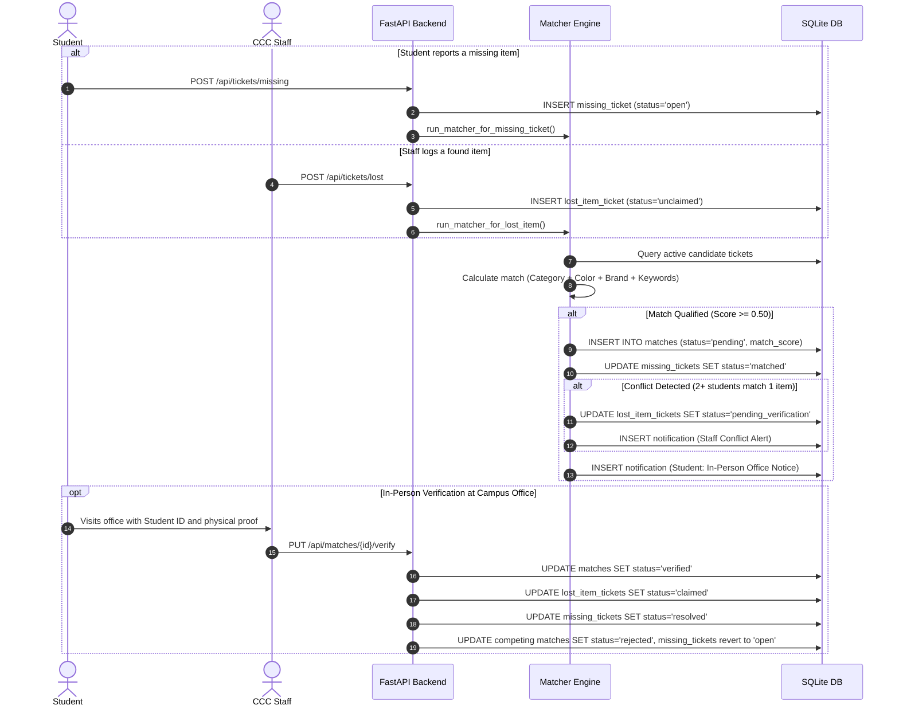

# FINDR — Matching Algorithm & Scoring Architecture

> **System**: Fast Item Notification, Detection, and Recovery (FINDR)  
> **Institution**: Cainta Catholic College (CCC)  
> **Source Code**: [`backend/utils/matcher.py`](file:///D:/Documents/_Non-admin%20Files/FINDR_files/FINDR_orig/backend/utils/matcher.py)

---

## 1. Flowchart: Matching & Scoring Logic

The following Mermaid diagram outlines the step-by-step decision tree executed whenever a ticket is submitted:

```mermaid
flowchart TD
    Start["Ticket Event Triggered<br>(Missing Report or Found Item Intake)"] --> FetchCandidates["Query Active Candidate Tickets<br>(Missing: open/matched | Found: unclaimed/pending_verification)"]
    
    FetchCandidates --> CatCheck{"Category Matches?<br>(missing.category == lost.category)"}
    
    CatCheck -- "No" --> RejectCat["Reject Match<br>Final Score = 0.0 (No Match)"]
    CatCheck -- "Yes" --> BaseScore["Set Base Score = 0.40 (40%)<br>Initialize Criteria Count = 0"]

    BaseScore --> ColorCheck{"Color Match?<br>(Case-insensitive substring)"}
    ColorCheck -- "Yes" --> AddColor["Score += 0.20<br>Criteria Count += 1"]
    ColorCheck -- "No" --> BrandCheck{"Brand Match?<br>(Case-insensitive substring)"}
    AddColor --> BrandCheck

    BrandCheck -- "Yes" --> AddBrand["Score += 0.20<br>Criteria Count += 1"]
    BrandCheck -- "No" --> KeywordCheck{"Keyword Overlap?<br>(item_name + description words)"}
    AddBrand --> KeywordCheck

    KeywordCheck -- "Yes (1+ overlapping words)" --> AddKeywords["Score += min(0.20, count * 0.10)<br>Criteria Count += 1"]
    KeywordCheck -- "No" --> EvalThreshold{"Criteria Count >= 1?<br>(At least 1 secondary trait)"}
    AddKeywords --> EvalThreshold

    EvalThreshold -- "No" --> RejectSecondary["Reject Match<br>Score = 0.0 (Insufficient criteria)"]
    EvalThreshold -- "Yes" --> Qualify["Match Qualified!<br>Final Score = min(1.0, Score)"]

    Qualify --> SaveMatch["Insert Row into 'matches' Table<br>(status = 'pending', match_score)"]
    SaveMatch --> ConflictCheck{"How many students match this found item?"}
    
    ConflictCheck -- "Single Match (1 Student)" --> SingleFlow["Missing Ticket -> 'matched'<br>Lost Item -> 'unclaimed'<br>Student Alerted (Privacy guarded)"]
    ConflictCheck -- "Multiple Matches (2+ Students)" --> ConflictFlow["Lost Item status -> 'pending_verification'<br>All Matched Students Alerted<br>Staff Alerted of Conflict"]

    SingleFlow --> OfficeVerif["In-Person Verification at CCC Office"]
    ConflictFlow --> OfficeVerif

    OfficeVerif --> StaffAction{"Staff Inspects Physical Item & Verifies True Owner"}
    StaffAction -- "Winning Student Verified" --> WinnerState["Lost Item -> 'claimed'<br>Missing Ticket -> 'resolved'<br>Match -> 'verified'<br>Appears in Returned Ledger"]
    StaffAction -- "Competing Students" --> CompeteState["Match -> 'rejected'<br>Missing Ticket -> reverts to 'open'<br>Eligible for future matches"]
```

---

## 2. Sequence Diagram: End-to-End Workflow

---

## 3. Scoring Rubric Breakdown

| Criterion | Points | Evaluation Rule | Example |
|---|---|---|---|
| **Category** *(Mandatory Gatekeeper)* | **+0.40** (40%) | **Strict exact equality.** If category does not match, the entire match fails immediately (Score = `0.0`). | `Electronics` == `Electronics` (+0.40) `Personal Items` != `Clothing` (0.0) |
| **Color** | **+0.20** (20%) | Case-insensitive substring match. | `"black"` matches `"matte black"` (+0.20) |
| **Brand** | **+0.20** (20%) | Case-insensitive substring match. | `"casio"` matches `"Casio fx-991CW"` (+0.20) |
| **Keywords** | **+0.10 to +0.20** (up to 20%) | Strips common stop words (`the`, `a`, `lost`, `found`, etc.) and checks for overlapping words between name and description. | 1 matching word = +0.10 2+ matching words = +0.20 |

### Qualification Threshold
- **Minimum Criteria**: Must match **Category PLUS at least 1 secondary trait** (`matched_criteria >= 1`).
- **Score Range**: Valid matches range from **0.50 (50%)** to **1.00 (100%)**.
- Items below `0.50` or with non-matching categories are rejected.

---

## 4. Why There is a Match Score

1. **Ranking Candidates for Staff**: When multiple items of the same category exist (e.g., several black umbrellas or calculators), the score sorts matches so staff sees the **strongest, highest-probability candidates first**.
2. **Prioritizing Multi-Attribute Matches**: Distinguishes between loose matches (e.g. only category + color = 60%) versus precise matches (category + color + brand + exact model keywords = 95%).
3. **Objective In-Person Verification**: Serves as a transparent audit trail for why the system alerted students and staff.

---

## 5. Student Privacy & Security Guard

- When a match is detected, the student notification **never reveals sensitive details** of the found item:
  > *"We found a possible match for your missing [Item Name]. Please visit the Lost and Found Office for in-person verification."*
- Exact pickup location, finder notes, and staff records remain hidden from students to prevent fraudulent claims. Ownership is validated physically in the office.
