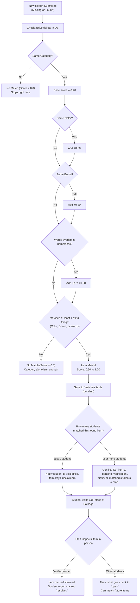

# How Matching & Scoring Works

Quick rundown of how FINDR matches lost items with found items and how the score works.

---

## 1. Flowchart

---

## 2. Points Breakdown

Total score is between **0.0** and **1.0** (0% to 100%).

| What it checks | Points | Notes |
|---|---|---|
| **Category** | **+0.40** | **Must match.** If this fails, everything stops and score is `0.0`. An umbrella won't match a phone. |
| **Color** | **+0.20** | Simple text check (e.g., "black" matches "matte black"). |
| **Brand** | **+0.20** | Simple text check (e.g., "casio" matches "Casio fx-991"). |
| **Keywords** | **up to +0.20** | Compares words in item name and description (ignores words like "the", "a", "lost"). |

### The main rule
To actually count as a match:
- Must have the **same Category**
- **PLUS at least 1 other thing** (Color, Brand, or Keywords)

If only the category matches and nothing else, it gets tossed out (score = 0.0). We don't want every lost ID matching every found ID.

---

## 3. Why is there a score?

- **Sorting**: If staff has 4 black umbrellas in the office, the one with 95% (same brand + model) shows up first before the 60% ones.
- **Tells you how close it is**:
  - `0.60` = kinda close (same category + color, unknown brand).
  - `0.95` = almost definitely it (category, color, brand, and model words all match).
- **Helps staff verify**: Staff doesn't have to read every single ticket. The highest score is probably the right one.

---

## 4. Conflicts (Multiple people matching 1 item)

If 2 students lost a black Casio calculator and staff logs 1 black Casio calculator:
1. Found item changes to `pending_verification`.
2. Both students get a notification to visit the office.
3. Staff checks the physical item (stickers, serials, scratches, proof).
4. Staff hits **Verify** on the real owner:
   - Winner gets marked `resolved` and item is `claimed`.
   - The other student's ticket gets set back to `open` so it can match future found items.

---

## 5. Privacy note

Students **never** see photos or where the item was found.
Their notification just says:
> *"We found a possible match for your missing [Item]. Please visit the Lost and Found Office for in-person verification."*

This stops people from looking at the details and pretending it's theirs.
